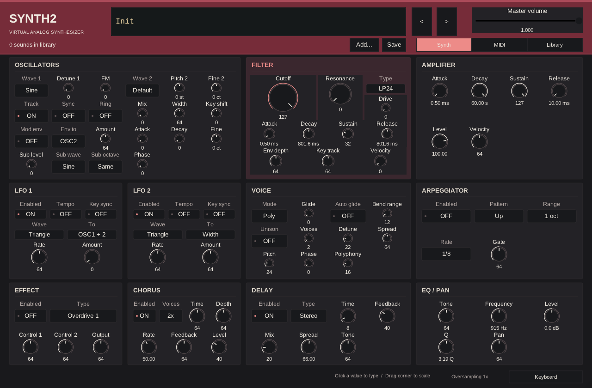

# Synth2

Synth2 is a virtual analog synthesizer with Synth1-compatible patch loading.
Load `.sy1` patches and ZIP banks directly, without extracting them, and shape
sounds from a single-panel interface.
Synth2 starts with Init and an empty library. Add your own patches or banks;
all imported sounds can be tagged, favorited and removed through the same UI.



The editor combines Synth1-inspired functional groups with restrained red accents,
warm-white legends and black controls. MIDI routing and the sound library have
their own supplementary views; serialized metadata stays outside the editor.

## Platforms and formats

| Platform | Plugin formats | Standalone |
| --- | --- | --- |
| Windows | VST3, CLAP | APP |
| macOS (Apple Silicon) | VST3, CLAP, AUv2 | APP |
| Linux (experimental) | VST3, CLAP | APP |

These are configured build targets, not certification of plugin/DAW operation.
See [capabilities and verification boundaries](docs/status.md) for the current scope.

## Install native packages

See [INSTALL.md](INSTALL.md) for Linux/Windows/macOS product locations, unsigned-build
prompts and plugin rescanning. Source archives require building; native candidate
packages are available from successful Actions runs.

## Build and test

Build the portable synthesis core, tools and tests with CMake 3.25+, Ninja, a
C++20 toolchain, Python 3 and Git:

```sh
cmake --preset core
cmake --build --preset core --parallel 4
ctest --preset core
```

The `core` preset uses `build-oos-core` and fetches GoogleTest for testing.
No plugin SDK, display, audio device, Synth1 DLL or Wine is required.

Build switches can also be set explicitly:

| Configuration | SYNTH2_BUILD_IPLUG2 | SYNTH2_BUILD_TOOLS | SYNTH2_BUILD_TESTS |
| --- | --- | --- | --- |
| Portable library only | OFF | OFF | OFF |
| Offline tools | OFF | ON | OFF |
| Portable tests only | OFF | OFF | ON |
| Native product only | ON | OFF | OFF |

`core` enables tools and tests; native presets disable both. Tests build the Probe
and WAV comparator they require even with optional tools disabled. Use a separate
build directory for each configuration; for example:

```sh
cmake -S . -B build-oos-tests -DSYNTH2_BUILD_IPLUG2=OFF -DSYNTH2_BUILD_TOOLS=OFF -DSYNTH2_BUILD_TESTS=ON
cmake --build build-oos-tests --parallel 4
ctest --test-dir build-oos-tests --output-on-failure
```

Local builds receive a dated development version. Release builds derive their
version from the Git tag; see [build versions](docs/desktop-build.md#build-versions).

Native products use the pinned `iPlug2/` submodule and additional SDK revisions
in [dependencies.lock.json](dependencies.lock.json). Run
`git submodule sync -- iPlug2` before `git submodule update --init iPlug2`, then follow the
[desktop build guide](docs/desktop-build.md). External `IPLUG2_DIR` checkouts
remain supported; CMake does not fetch or update SDKs. All platforms use the same
pinned development branch of iPlug2; see the build guide for Linux requirements.

[GitHub Actions](docs/ci.md) runs SDK-free portable tests on three platforms and
builds native candidates on Linux/Windows/macOS. Portable test success does not establish
native plugin or DAW operation.

## Documentation

| Topic | Guide |
| --- | --- |
| Capabilities and verification limits | [Product status](docs/status.md) |
| Product behavior and architecture | [Product contracts](docs/README.md) |
| Portable tests and focused checks | [Testing](tests/README.md) |
| Plugin and standalone builds | [Desktop build guide](docs/desktop-build.md) |
| Editor behavior and design previews | [GUI guide](docs/gui/README.md) |
| Rendering, inspection and diagnostics | [Development tools](tools/README.md) |
| Test inputs and evidence | [Evidence](docs/contracts/validation.md) |
| Distribution considerations | [Distribution requirements](docs/publication/README.md) |

## License

SPDX-License-Identifier: GPL-3.0-or-later

Synth2's project-owned source code is free software: you can redistribute it and/or
modify it under the terms of the GNU General Public License as published by the
Free Software Foundation, either version 3 of the License, or (at your option)
any later version.

It is distributed in the hope that it will be useful, but WITHOUT ANY WARRANTY;
without even the implied warranty of MERCHANTABILITY or FITNESS FOR A PARTICULAR
PURPOSE. See [LICENSE](LICENSE) for the complete terms.

Third-party components and fonts retain their own licenses and notices. This grant
does not establish redistribution rights for separately authored user patches
or historical assets; see the
[distribution requirements](docs/publication/README.md).
